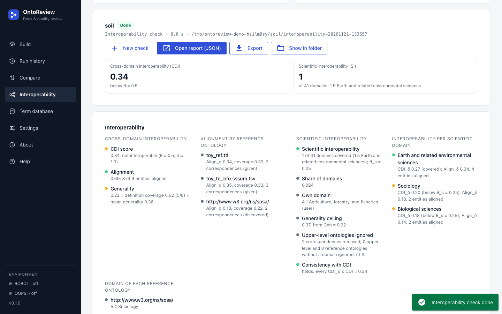
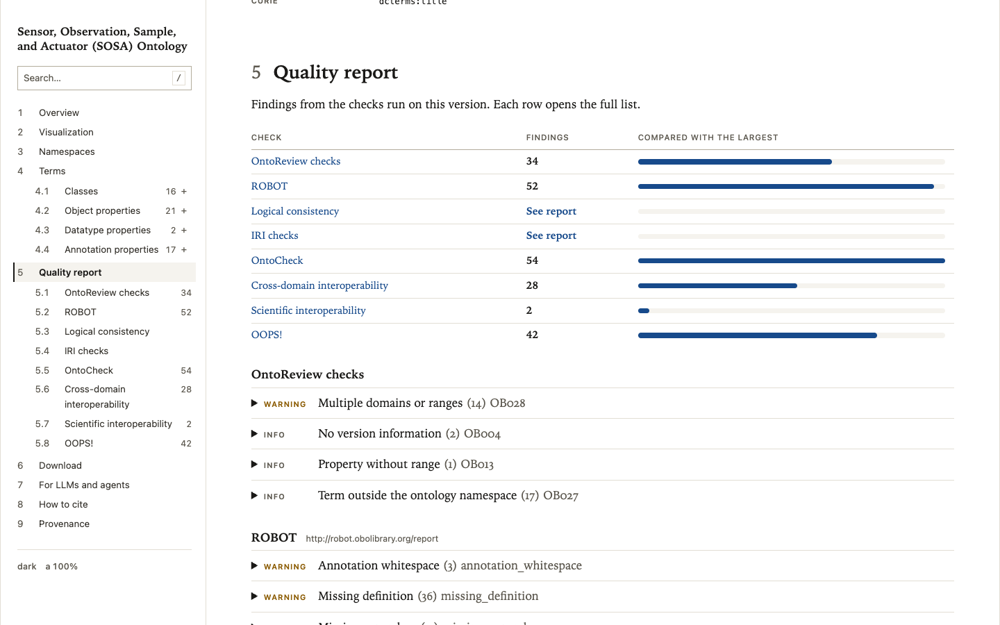
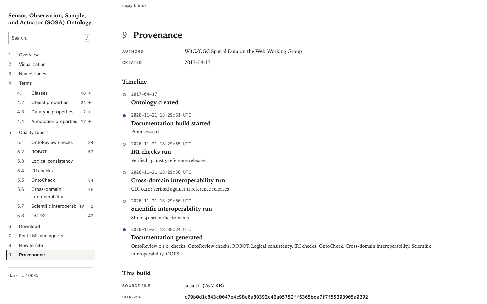
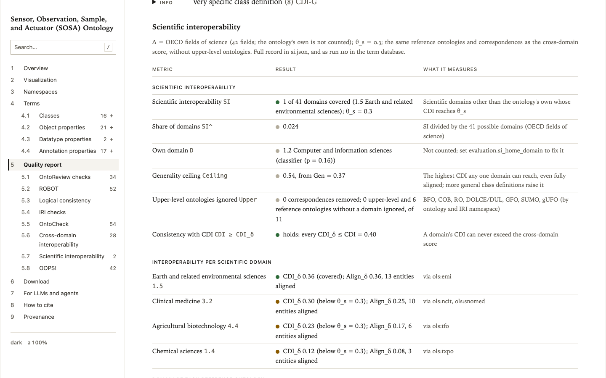
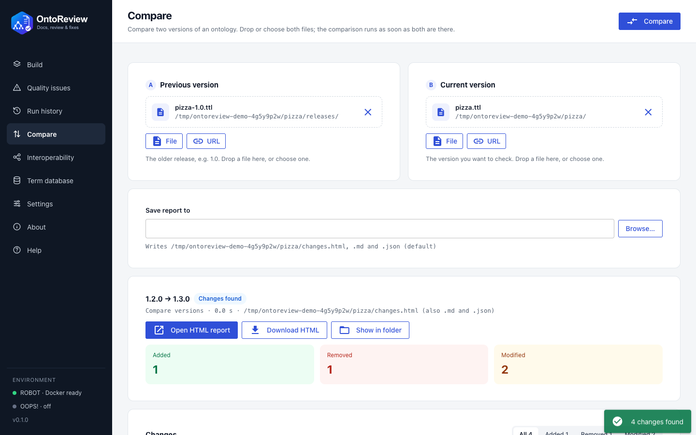
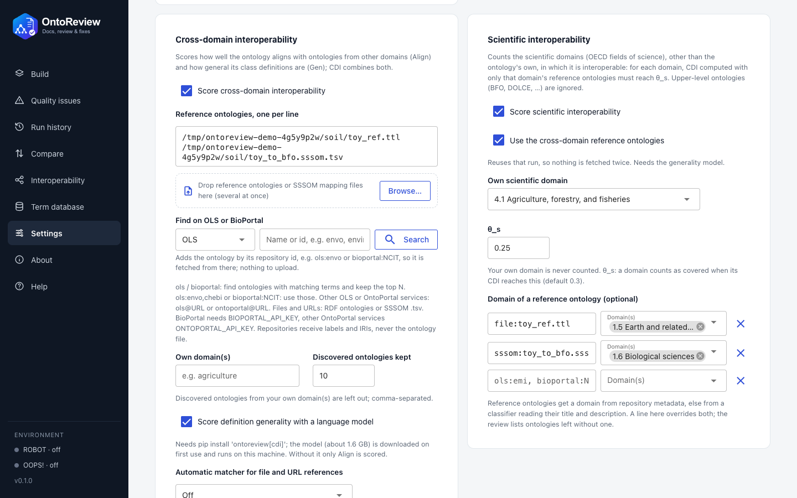

<p align="center">
  <picture>
    <source media="(prefers-color-scheme: dark)" srcset="src/ontoreview/ui_assets/brand/logo-dark.svg">
    
  </picture>
</p>

**Documentation, quality review and interoperability scores for OWL, RDFS, SKOS and LinkML ontologies.**
Pure Python, no Java. One app or one command; the result is a self-contained website you can publish anywhere.


## Quick start

```bash
pip install "ontoreview[ui]"          # Python 3.11+; add [cdi] for the interoperability language model
ontoreview ui                         # opens the app at http://127.0.0.1:8765
```

Choose an ontology (file, folder or URL, or drag it in), keep **Website**, press **Build docs**.

For scripts and CI:

```bash
ontoreview build my-ontology.ttl -o docs          # the website
ontoreview check my-ontology.ttl --fail-on error  # quality checks only, CI exit code
```

## Key features

- **Documentation website.** Every class, property, individual and SKOS concept with labels, definitions, axioms in Manchester syntax and back-links; an overview with statistics; an interactive diagram (VOWL or UML); search; downloads in Turtle, RDF/XML, JSON-LD and N-Triples; how to cite. Works offline, in dark mode, on phones and in print. Also as one `standalone.html`, Markdown or MyST.
- **Fix first, then document.** Before the docs are built, review suggested fixes (exact rule fixes, your values, AI-drafted definitions) and required metadata; fixes go to a new file (`a-v1.ttl`), never the original, and are recorded in the provenance.
- **Quality review.** 25 built-in rules plus ROBOT, a reasoner (HermiT/ELK), IRI checks, OntoCheck metrics and OOPS!, in one report with a summary per check.
- **Cross-domain interoperability (CDI).** How well the ontology aligns with ontologies from other domains, and how general its definitions are.
- **Scientific interoperability (SI).** In how many scientific fields (the 41 OECD fields of science) it is interoperable, ignoring upper-level ontologies.
- **Reference ontologies your way.** Upload files or SSSOM mappings, find and add ontologies on OLS or BioPortal by name, or let OntoReview discover them.
- **Provenance you can cite.** Each run records when it ran, the source file's SHA-256, and the exact release of every reference ontology it was checked against (once, with what used it), as JSON and PROV-O.
- **Compare versions.** Added, removed and changed terms and axioms, as an HTML report or a changelog in the docs.
- **Run history.** Every run with its configuration: re-run it as is, change it and run again, or export it as a .zip. Each run gets its own folder and is never overwritten.
- **Deploy in one click.** Every website includes `DEPLOY.md`, a Dockerfile, an nginx config and a GitHub Pages workflow. The app can push a website to GitHub and publish it on GitHub Pages.
- **Also:** LinkML schemas, folders of ontologies, multilingual sites, competency questions, files for LLMs and agents (`llms.txt`), themes and plugins.

## Fixes and AI suggestions

Before any docs are generated, **Build docs** opens the **Quality issues** page:

- **Required metadata** first: title, description, license and creators (name, ORCID, email; add as many as needed; the ORCID is looked up by name and you pick the right person). The docs are not generated without them.
- **Suggested fixes** for each issue, with a confidence and who made them: **Rule** (exact edits), **Your input**, **Ranked** candidates or **AI**. The centre shows the Turtle change, the right side what changes in the ontology and in the docs.
- **AI suggestions** (on by default, never applied without your acceptance): definitions to edit, ranked domains and ranges with reasons that you can pick or replace with your own choice, and a description. Accepted AI text is marked **AI-assisted** in the docs and in `provenance.ttl`.
- **Where AI runs** (Settings › AI & fixes, reorderable): a local **Ollama** first (installed models are listed, new ones can be pulled), then an open-source **Hugging Face** model (default `Qwen/Qwen3.5-4B`, Apache-2.0, downloaded once with progress), then an **API key** (OpenAI, Anthropic, OpenRouter, …).
- **Come back later**: the Quality issues page lists every checked ontology with its status (waiting / built), kept across restarts; each is built only when you apply or skip it, with its own settings.
- **Apply N fixes & build** writes a new file (`a-v1.ttl`, `a-v1.yaml` for LinkML) with a patch and a record; the original is never changed. **Skip and build** uses the original.
- **LinkML**: definitions, titles, domains and ranges of classes, slots, enums and class attributes go into the YAML copy. A fix the YAML cannot hold (e.g. on an imported term) saves the fixed version as OWL (`a-v1.ttl`, generated from the schema) plus a YAML patch of the rest.
- **Long lists**: open issues stay on top; accepted or ignored ones move to the end.
- **Prompts**: the exact prompts sent to the model are in [`src/ontoreview/fixes/ai/prompts.md`](src/ontoreview/fixes/ai/prompts.md); edit it, or point `ONTOREVIEW_PROMPTS` at your own copy.

Command line: `ontoreview fix list a.ttl [--ai]` and `ontoreview fix apply a.ttl --accept-safe --set license=… --set creators="Name | ORCID | email"`.

## Screenshots

| | |
|---|---|
|  |  |
| **Build** – results, quality metrics and issues | **Interoperability** – CDI and SI for one ontology |
|  |  |
| **Docs** – quality report: a plain-language summary, each issue once (with the checks that found it), then each check's own report | **Docs** – provenance with timestamps |
|  |  |
| **Docs** – interactive diagram | **Docs** – scientific interoperability per domain |
|  |  |
| **Run history** – re-run as is or changed, export | **Deploy** – push to GitHub Pages |
|  |  |
| **Compare** – what changed between versions | **Settings** – references, domains, OLS/BioPortal search |

## Commands

| Command | What it does |
|---|---|
| `ontoreview ui` | The app (recommended) |
| `ontoreview build SOURCE -o docs` | Documentation website (`--single-file` for one HTML file) |
| `ontoreview check SOURCE` | Quality checks; `--interop-only` for CDI and SI only |
| `ontoreview diff OLD NEW` | Compare two versions |
| `ontoreview export SOURCE --format markdown` | Markdown or MyST pages |
| `ontoreview serve SOURCE` | Live preview while you edit |
| `ontoreview init SOURCE` | Create `ontoreview.toml` and a CI workflow |

`SOURCE` is a file, a URL or a folder of ontologies. Settings can live in `ontoreview.toml` next to the
ontology, so the app, the command line and CI build exactly the same docs.

## Learn more

- **[Guide](guide/GUIDE.md):** every feature, option, check and configuration key.
- **In the app:** Help (searchable, with screenshots).
- **Examples:** `python scripts/build_examples.py && python -m http.server -d examples`.

## Development

```bash
python -m venv .venv && .venv/bin/pip install -e '.[dev]'
.venv/bin/pytest
```

MIT License.
