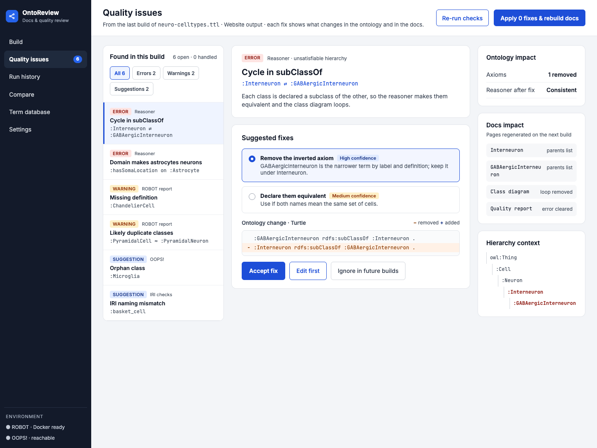

# Fixing quality findings

*Plan, not implemented yet.*

## Rule

- OntoReview **suggests**, the user **decides**.
- The original ontology is **never changed**: fixes go to a new file.
- **Fix first, then document:** the docs are generated only after the user applies fixes or skips them.

## How it works (Build website)

1. User presses **Build docs**.
2. The checks run and fixes are suggested; **no docs yet**.
3. If **required metadata** is missing, the user must fill it in first (see below).
4. User chooses:
   - **Apply fixes** (all or some) → a new file is written, then the docs are built from it.
   - **Skip** → skips the optional fixes; the docs are built from the original file.
5. Fixes not applied stay open. Applying more later writes **another** new file.

## Required metadata

The docs are **not generated** until these are present:

| Field | Written as |
|---|---|
| Title | `dcterms:title` |
| Description | `dcterms:description` |
| License | `dcterms:license` (picked from a list, e.g. CC BY 4.0) |
| Creator(s) | `dcterms:creator` (name, ORCID optional) |

- Missing values are asked for in a short form; they **cannot be skipped**.
- The values go into the new file (`a-v1.ttl`), like any other fix.
- An AI draft can suggest the description; the user confirms it.

## Versions

| File | What it is |
|---|---|
| `a.ttl` | Original, never changed |
| `a-v1.ttl` | `a.ttl` + the fixes applied in the first build |
| `a-v2.ttl` | `a-v1.ttl` + fixes applied later |

**Run history** lists the build of `a-v1.ttl` with a note: *"Fixed version of a.ttl · 3 of 5 fixes applied"*, linked to the original run.

## Provenance

Every applied fix is recorded:

| What | Example |
|---|---|
| Change | `+ :Microglia skos:definition "…"` |
| Finding it fixes | OB011 · no definition |
| Fix type | AI draft, edited by the user |
| Made by | Rule id · OntoAligner model + threshold · LLM source, model and revision |
| Accepted | When (and by whom, if known) |
| Files | `a.ttl` (SHA-256) → `a-v1.ttl` (SHA-256) |

**`provenance.ttl`** adds:
- `a-v1.ttl` `prov:wasDerivedFrom` `a.ttl`
- a "fixes applied" activity, with each fix linked to the model or rule that produced it (`prov:wasAssociatedWith`)

**Docs › Provenance** adds:
- a timeline entry: *"3 fixes applied (2 rule, 1 AI draft)"*
- a table of applied fixes: term, change, made by, accepted at

Not-applied fixes are not recorded in the docs.

## Example

**Found:** `:Microglia` has no definition.

**Suggested** (AI draft):

```turtle
:Microglia skos:definition "A glial cell that acts as the main immune defence of the central nervous system."@en .
```

**User:** edits the wording, then **Apply fixes**.

**Result:** `brain-v1.ttl` is written with the definition and the docs are built from it; `brain.ttl` is unchanged.

## Types of fixes

| Type | Found | Suggested fix |
|---|---|---|
| **Automatic** | Label `" Neuron "` has extra spaces | `"Neuron"` |
| **Ranked choice** | `:Microglia` has no parent | 1. `:GlialCell` (0.91) · 2. `:Cell` (0.64) |
| **User input** (required) | No license | User picks `CC BY 4.0` |
| **AI draft** | `:Microglia` has no definition | Drafted definition (see above) |
| **Manual** | `:A` is both a subclass of and disjoint with `:B` | Both axioms shown; the author decides |

## AI access

Off by default. When on, OntoReview uses the first available source:

| Priority | Source | Model |
|---|---|---|
| 1 | **Hugging Face** (runs locally) | Default: open-source Qwen 3.5 (4B; 2B on small machines) |
| 2 | **Ollama**, if installed | Default: `qwen3.5:4b` |
| 3 | **API key**, if provided | Chosen by the user (OpenAI, Anthropic, OpenRouter, …) |

In **Settings › AI**, the user can:
- **set the priority:** reorder Hugging Face, Ollama and API key, or use only one;
- **change the model** for each source (any Hugging Face or Ollama model, any model the API offers).

Unavailable sources are skipped; local sources keep the ontology on this computer.

## In the app

- After **Build docs**, a **Review fixes** step appears before the docs are generated.
- Missing required metadata is shown first as a short form; **Build** stays disabled until it is filled in.
- Each issue shows the suggested fix and what it changes; tick the ones to apply.
- Buttons: **Apply fixes and build** · **Skip and build**.
- Open fixes stay on the **Quality issues** page for later.

## UI design (idea)



| Area | Shows |
|---|---|
| **Sidebar** | *Quality issues* with a count of open issues |
| **Header** | File and output · **AI on/off** with the active source and model (e.g. *Ollama · qwen3.5:4b*; click to switch source or model) · **Re-run checks** · **Apply N fixes and build** |
| **Left** | Issues found, filtered by All / Errors / Warnings / Suggestions |
| **Centre** | The issue and its ranked fixes, each with a confidence and a **Rule / Aligner / AI draft** badge · Turtle diff · **Accept** · **Edit first** · **Ignore in future builds** |
| **Right** | Ontology impact (axioms, reasoner) · Docs impact (pages that change) · Context (e.g. class hierarchy) · Who made the fix (rule or model) |

Corrections to the mockup:
- A two-class cycle is found by the **built-in rules (OB014)**, not the reasoner, and is not "unsatisfiable".
- *"Domain makes astrocytes neurons"* is dropped: no check reports it.
- When AI is off, AI drafts are hidden with a note; rule and aligner fixes still show.

## Steps

1. Automatic and user-input fixes
2. The Quality issues page
3. Ranked choices
4. AI drafts

---

# Appendix: implementation reference

## Categories

| Category | Meaning | Who decides |
|---|---|---|
| **D: deterministic** | An exact edit computed by rules, with no model. Some offer two or three exact options. | The user accepts it. |
| **A: aligner** | Candidates ranked by OntoAligner (no LLM): mappings, successors, parents, likely duplicates. An LLM, if configured, only writes the explanation. | The user picks a candidate or rejects all. |
| **U: user input** | The fix needs a value only the user knows (license, creators), or the user must confirm a guess. | The user fills in or confirms a value. |
| **L: LLM** | The fix needs new text: definitions, descriptions, distinguishing labels. | The LLM drafts; the user accepts, edits or rejects. |
| **M: manual** | A modelling decision. No edit is proposed; the tool shows the evidence, and an LLM may explain likely causes. | The ontology author. |

**Flags on each fixer:**
- **safe:** exactly one option, no guessing, not breaking, no change in meaning. Only safe fixes can be accepted in bulk.
- **guess:** the fix rests on a heuristic, such as string similarity or a dominant language. It is never bulk-accepted, and the user confirms it.
- **breaking:** the fix renames an IRI. Renames are opt-in, and only in the **deprecate-and-replace** form: the old IRI stays, marked `owl:deprecated true` with `dcterms:isReplacedBy` pointing to the new IRI, so old links keep working. Fixing the label is the default.

## Built-in rules (`src/ontoreview/quality_checks/rules.py`)

| Rule | Finding | Cat. | Suggested fix | Flags |
|---|---|---|---|---|
| OB001 | No title | U (L can draft) | Add `dcterms:title` | required |
| OB002 | No description | L | Draft `dcterms:description` / abstract from the ontology's terms | required |
| OB003 | No license | U | Add `dcterms:license`, chosen from the SPDX/CC list in `model/licenses.py` | required |
| OB004 | No version info | U + D | User gives `owl:versionInfo`. `owl:versionIRI` is derived from a pattern the user can configure and confirms: default `<ontology IRI>/<version>/`, with an OBO-style `<base>/releases/<date>/<file>` option | |
| OB005 | No creators | U | Add `dcterms:creator` (name, ORCID) | required |
| OB006 | No preferred prefix | D | Add `vann:preferredNamespacePrefix` / `Uri` from the prefix bound to the namespace | safe |
| OB010 | Term without label | D, else U/L | Label from a *readable* local name (split camelCase/snake_case). Opaque IDs such as `CL_0000540` are detected and fall back to the user or the LLM | safe only for readable names |
| OB011 | Term without definition | L | Definition in "genus–differentia" form ("An X that …") from the label, parents, siblings and external matches | |
| OB012 | Property without domain | L (D seed) | Seed: classes the property is used on in restrictions; the LLM proposes the rest | |
| OB013 | Property without range | L (D seed) | Seed: fillers of `someValuesFrom` / `allValuesFrom`; the LLM proposes the rest | |
| OB014 | Subclass cycle | D (choice) for 2 classes; M for longer | Two classes: remove one axiom (the narrower term stays under the broader) or declare them equivalent, ranked. Longer cycles: show the path | |
| OB015 | Undeclared term | D (choice) / A | Declare `rdf:type` from where it's used. For properties this is a choice (object or datatype), since usage can be ambiguous. Or suggest the declared IRI it most resembles, as a likely typo | guess |
| OB016 | Duplicate labels | L (or U) | Propose distinguishing labels for each term | |
| OB017 | Several labels in one language | U | User picks which label stays `rdfs:label`; the others become `skos:altLabel` | |
| OB018 | Deprecated without replacement | A (+ L explanation) | OntoAligner ranks the ontology's own terms as successors; add `dcterms:isReplacedBy` / `IAO:0100001` | |
| OB019 | Naming convention | D | Default: fix the label. Opt-in: rename the IRI (deprecate-and-replace) | breaking (rename) |
| OB020 | Subclass of and disjoint with | M | Show both axioms; the author removes one | |
| OB021 | Transitive and functional | M | Explain the conflict; the author removes one characteristic | |
| OB022 | Self-reference | D | Remove `X subClassOf X` / `X equivalentClass X` / `P subPropertyOf P` | safe |
| OB023 | Orphan class | A (+ L explanation) | OntoAligner ranks existing classes as parents | |
| OB024 | Wrong kind of range | D (choice) | Option A: change the range. Option B: switch the property type (Datatype ↔ Object). Option B affects every assertion using the property, so it is ranked second | close to breaking (option B) |
| OB025 | Inverse of itself, not symmetric | D (choice) | Ranked first: add `owl:SymmetricProperty` (already implied by `P owl:inverseOf P`; **changes nothing logically**). Second: remove `owl:inverseOf` (**changes the meaning**) | |
| OB026 | Missing language tags | U (D proposes) | Proposes the dominant language tag; the user confirms, because the untagged label may be in another language | guess |
| OB027 | Term outside the namespace | M | Informational; nothing to edit | |
| OB028 | Multiple domains / ranges | D (choice) | Rewrite as `owl:unionOf`, warning that this changes the meaning (intersection → union); or keep as is | |

(OB007–OB009 don't exist.)

## Competency questions (`src/ontoreview/cq.py`)

| Code | Finding | Cat. | Suggested fix |
|---|---|---|---|
| CQ001 | Question not answerable | L | Suggest missing terms or axioms, or an adjusted SPARQL query |
| CQ002 | SPARQL query error | L | Fix the query. This edits the CQ file, not the ontology |

## ROBOT report (`src/ontoreview/report/robot.py`)

Rule names come from ROBOT's default report profile (from its documentation); verify against a real report.

| ROBOT rule | Cat. | Suggested fix | Flags |
|---|---|---|---|
| missing_label | D, else U/L | As OB010 | as OB010 |
| missing_definition | L | As OB011 | |
| duplicate_label | L | As OB016 | |
| multiple_labels | U | As OB017 | |
| label_whitespace, annotation_whitespace | D | Trim and collapse whitespace | safe |
| label_formatting | D | Remove the illegal characters reported | |
| lowercase_definition | D | Capitalise the first letter | safe |
| duplicate_definition, multiple_definitions | U | User picks or merges | |
| duplicate_exact_synonym, duplicate_scoped_synonym, duplicate_label_synonym | D | Remove the duplicate triple | safe |
| missing_ontology_title / description / license | U / L / U | As OB001 / OB002 / OB003 | required |
| deprecated_class_reference, deprecated_property_reference | D if a replacement is recorded, else A | Replace the reference with the successor term | |
| missing_obsolete_label, misused_obsolete_label | D | Add or remove the "obsolete " label prefix | safe |
| misused_replaced_by | D | Remove `replaced_by` from the non-deprecated term | safe |
| missing_superclass | A (+ L explanation) | As OB023 | |
| equivalent_pair, multiple_equivalent_classes | M | Show them; the author decides | |
| invalid_xref | D, else U | Reformat to `PREFIX:ID` when unambiguous | |

## Logical consistency (`src/ontoreview/report/reasoner.py`)

| Code | Cat. | Suggested fix |
|---|---|---|
| inconsistent_ontology | M | No edit. An LLM may explain likely causes once reasoner explanations are available |
| unsatisfiable_class | M | Same |
| outside_owl2_dl | M | Show ROBOT's message; the author removes the non-DL construct |

## IRI checks (`src/ontoreview/report/iri.py`)

| Code | Cat. | Suggested fix | Flags |
|---|---|---|---|
| invalid_iri (own term) | D | Percent-encode or rename (deprecate-and-replace) | breaking |
| invalid_iri (external reference) | D / A | Percent-encode, or match against known terms in the term database | |
| no_ontology_header | D | Add an `owl:Ontology` named by the namespace (without the trailing `#`/`/`) | |
| multiple_ontology_headers | U | User picks the one to keep | |
| version_iri_equals_ontology_iri | U + D | Propose a versionIRI from the configured pattern (as OB004) | |
| ontology_iri_not_resolvable | M | A publishing issue; point to the generated `.htaccess` / w3id files | |
| stale_term_lookup | action | "Refresh" the vocabulary; no ontology edit | |
| release_mismatch | D | Point `owl:imports` at the verified release, or refresh | |
| deprecated_external_term | D if OLS gives a replacement, else A | Replace references with `term_replaced_by`; else OntoAligner ranks OLS candidates | |
| external_term_wrong_type | A (+ L explanation) | OntoAligner ranks OLS candidates of the expected type, or "none" | |
| unverified_external_term | A (or U) | As above; or the user adds the vocabulary to the term database | |

## OntoCheck (`src/ontoreview/report/ontocheck.py`)

| Code | Cat. | Suggested fix | Flags |
|---|---|---|---|
| checkLabel | D, else U/L | As OB010 | as OB010 |
| definitionCheck | L | As OB011 (OntoCheck only looks at `skos:definition`) | |
| isolatedElements | A (+ L explanation) | As OB023 | |
| missingDomainRange | L (D seed) | As OB012 / OB013 | |
| classCapitalCheck | D | Capitalise the label; renaming the IRI is opt-in | breaking (rename) |
| classSpaceCheck | D | Replace spaces in the IRI (deprecate-and-replace) | breaking |
| duplicateLabels | L | As OB016 | |
| spellCheck | D | Apply the computed correction, per word | guess |
| humanLicense | U | As OB003 | |
| sparqlEndpoint, rdfDump | U | User corrects or removes the URL | |

## OOPS! (`src/ontoreview/report/oops.py`)

| Pitfall | Cat. | Suggested fix |
|---|---|---|
| P04 unconnected elements | A (+ L explanation) | As OB023 |
| P07 merging different concepts | M | Explain; the author splits the class |
| P08 missing annotations | D (label) / L (definition) | As OB010 / OB011 |
| P10 missing disjointness | L | Propose sibling pairs to make disjoint; the user confirms |
| P11 missing domain or range | L | As OB012 / OB013 |
| P12 equivalent properties not explicit | D (confirm) | Add `owl:equivalentProperty` for the reported pair |
| P13 inverse relationships not explicit | L | Propose inverse pairs; the user confirms |
| P19 multiple domains or ranges | D (choice) | As OB028 |
| P22 inconsistent naming | D | As OB019 |
| P30 equivalent classes not explicit | D (choice) / A | "Likely duplicate classes": OntoAligner confirms the pair; then declare `owl:equivalentClass`, or merge (deprecate one with a replacement) |
| P34 untyped class, P35 untyped property | D | As OB015 |
| P38 no ontology declaration | D | As no_ontology_header |
| P41 no license | U | As OB003 |
| other P-codes | M | Show OOPS!'s explanation |
