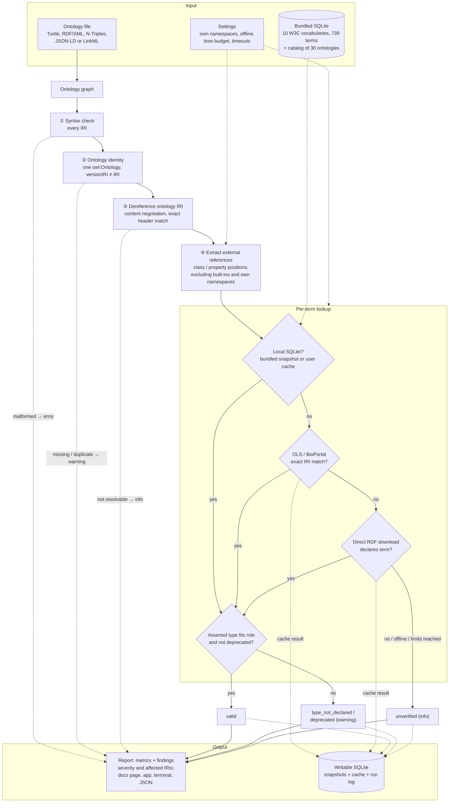

# Quality checks in OntoReview

This page lists every quality check OntoReview runs, the order they run in, and how to configure them.

## When checks run

Checks run when you produce:

- a **Website** or a **Single HTML file** (the results appear in the "Quality report" section of the docs and in the app's Issues table),
- a **Quality check only** report in the app, or `ontoreview check` on the command line.

Markdown and MyST exports, and **Compare versions**, don't run quality checks.

## Order

1. **Parse and extract** the ontology. This is not a check itself; every rule works on its output.
2. **Built-in rules** OB001 → OB028, in ID order, then any rules added by plugins.
3. **ROBOT report**, using a local `robot` command or the `obolibrary/robot` Docker image.
4. **Logical consistency**, an OWL reasoner (HermiT by default, or ELK) run with `robot reason` through the same local `robot` or Docker image. It needs ROBOT, so it is skipped when ROBOT is off or unavailable.
5. **IRI checks**: IRI syntax, the ontology header and version IRI, whether the ontology IRI resolves to RDF describing this ontology, and whether reused external classes and properties exist in their vocabulary (see below). Terms are looked up in SQLite first; network lookups only send external term IRIs, never your ontology.
6. **OntoCheck metrics**, run in-process with the [OntoCheck](https://ontocheck.readthedocs.io) library: a scorecard of labeling, structural, accessibility and naming-convention metrics (see below). Only the SPARQL-endpoint and RDF-dump checks use the network, to contact URLs the ontology declares.
7. **OOPS! pitfall scan**, the OOPS! web service. It runs alongside ROBOT, because the two check different things (see below). When the ROBOT report ran, OOPS! leaves out the pitfalls ROBOT already checks (P08, P32, P41), and its section says so. When ROBOT could not run (no Docker, ROBOT failed, or ROBOT turned off), OOPS! runs its full catalogue. **OOPS! uploads the ontology to oops.linkeddata.es**; set it to "off" for private ontologies.
8. **Competency questions**, when a competency-questions file is given. Each SPARQL query runs against the ontology plus any example data.

Counts are per affected element: a ROBOT rule that flags two terms counts as two findings, like the built-in rules, which report one finding per term. Overall totals (the `ontoreview check` summary line, the app's tiles and the JSON `totals`) include every checker. The JSON `summary` field and the docs' "OntoReview checks" line count the built-in rules only.

Results are not shown in run order. Built-in findings are sorted by severity (errors, then warnings, then info), then by rule ID and term. ROBOT, logical-consistency and OOPS! results appear as their own sections of the quality report. In the app's Issues table, all of them are merged and sorted by severity.

## Built-in rules

### Ontology metadata

| ID | Severity | Rule | What it checks |
|---|---|---|---|
| OB001 | warning | Ontology has no title | `dcterms:title` (or `rdfs:label`) on the `owl:Ontology` node |
| OB002 | warning | Ontology has no description | `dcterms:description` or `dcterms:abstract` |
| OB003 | warning | No license declared | `dcterms:license` |
| OB004 | info | No version information | `owl:versionInfo` and `owl:versionIRI` |
| OB005 | warning | No creators | `dcterms:creator` |
| OB006 | info | No preferred prefix/namespace | `vann:preferredNamespacePrefix` and `vann:preferredNamespaceUri` |

### Documentation of terms

| ID | Severity | Rule | What it checks |
|---|---|---|---|
| OB010 | warning | Term without a label | every term has an `rdfs:label` or `skos:prefLabel` (OOPS! P08) |
| OB011 | warning | Term without a definition | every term has `skos:definition`, IAO:0000115 or `rdfs:comment` (OOPS! P08) |
| OB016 | warning | Duplicate labels | no two terms share a label |
| OB017 | warning | Multiple labels in one language | no term has two labels in the same language |
| OB026 | info | Missing language tags | if some labels have language tags, all of them do |
| OB018 | info | Deprecated term without replacement | deprecated terms point to a replacement with `dcterms:isReplacedBy` |

### Structure and logic

| ID | Severity | Rule | What it checks |
|---|---|---|---|
| OB014 | error | Cycle in class hierarchy | no class is (indirectly) a subclass of itself (OOPS! P06) |
| OB015 | error | Undeclared term | every term used in the ontology namespace is declared with `rdf:type` (OOPS! P34/P35) |
| OB020 | error | Class both subclass of and disjoint with another | no class is a *direct* asserted subclass of a class it is disjoint with |
| OB021 | error | Transitive property used as functional | no property is both transitive and (inverse) functional (not allowed in OWL 2 DL) |
| OB024 | error | Wrong kind of range | datatype properties have a datatype range; object properties have a class range |
| OB022 | warning | Self-referencing definition | no class is equivalent to, or a subclass of, itself (OOPS! P24/P27) |
| OB025 | warning | Inverse of itself but not symmetric | a property that is its own inverse is declared symmetric instead (OOPS! P25) |
| OB028 | warning | Multiple domains or ranges | properties don't have several `rdfs:domain`/`rdfs:range` axioms, which are read as their intersection (OOPS! P19) |
| OB012 | info | Property without domain | properties declare `rdfs:domain`; ignored when the property is used in class axioms (OOPS! P11) |
| OB013 | info | Property without range | properties declare `rdfs:range` (OOPS! P11) |
| OB023 | info | Orphan class | no class lacks superclasses, subclasses and any use |

### Style

| ID | Severity | Rule | What it checks |
|---|---|---|---|
| OB019 | info | Inconsistent naming convention | classes are UpperCamelCase and properties lowerCamelCase (OOPS! P22) |
| OB027 | info | Term outside the ontology namespace | lists declared terms in other namespaces (they are documented as external) |

## Competency questions

| ID | Severity | Rule | When it is reported |
|---|---|---|---|
| CQ001 | warning | Competency question not answerable | the question's SPARQL query returned no results |
| CQ002 | error | Competency question query error | the query could not be run, for example because of a syntax error |

Questions without a query are listed as "not tested" and are not reported as findings.

## External checkers

**ROBOT report** (<http://robot.obolibrary.org/report>) runs ROBOT's quality-control queries. These include missing or duplicate labels, missing definitions, references to deprecated terms and multiple labels. ROBOT grades each result as error, warning or info.

**Logical consistency** (<http://robot.obolibrary.org/reason>) runs an OWL reasoner over the ontology (including loaded imports). Nothing leaves your machine.

| Code | Severity | Reported when |
|---|---|---|
| `inconsistent_ontology` | error | the ontology has no model, for example an individual typed with two disjoint classes |
| `unsatisfiable_class` | error | a class can never have members, for example a subclass of two disjoint classes; the classes are listed |
| `outside_owl2_dl` | warning | HermiT refused the ontology because it breaks an OWL 2 DL restriction (for example a transitive property in a cardinality restriction); the offending axiom is shown, and consistency was not checked |

When there are no problems, the section says "Consistent; all classes satisfiable (HermiT)". HermiT is complete for OWL 2 DL but can be slow on very large ontologies. ELK is much faster but only understands OWL 2 EL, so it can miss problems that depend on other constructs. The reasoner stops after `evaluation.reasoner_timeout` seconds (default 600). For an explanation of a problem, open the ontology in Protégé and use its explanation feature.

**IRI checks** produce a small scorecard plus findings:

| Metric | What it checks | Finding when it fails |
|---|---|---|
| IRI syntax | every IRI against the full RFC 3987 `IRI` grammar (with RFC 3986 IP literals); also a host for `http(s)`, no credentials, ports 0–65535. The message names the failing component | `invalid_iri`, error |
| Ontology header | exactly one named `owl:Ontology` | `no_ontology_header` / `multiple_ontology_headers`, warning |
| Version IRI | an `owl:versionIRI` distinct from the ontology IRI | `version_iri_equals_ontology_iri`, info |
| Ontology IRI resolves | the ontology IRI returns RDF (content negotiation) whose header is that IRI | `ontology_iri_not_resolvable`, info (normal for unpublished ontologies) |
| External terms | reused classes and properties exist in their vocabulary, with the expected type, and are not deprecated | `deprecated_external_term` and `external_term_wrong_type`, warning; `unverified_external_term`, info |
| Lookup sources | where each external term was verified | — |
| Freshness | whether any term was verified from an entry older than `iri_cache_days` that could not be refreshed | `stale_term_lookup`, info |
| Releases verified against | the vocabulary release (version IRI, or repository version) each term was checked against | `release_mismatch`, warning: the ontology `owl:imports` a different release |

External terms are found in class and property positions: predicates, `rdf:type` objects, subclass, equivalent and disjoint classes, domains and ranges, restrictions, and property relationships. Not checked as external:

- RDF, RDFS, OWL and XSD built-ins
- the ontology's own namespaces: its detected namespace, `evaluation.iri_local_namespaces`, namespaces of its IRI, and namespaces where it declares terms on the same host, unless the vocabulary is in the catalog

Lookup order:

1. **Local SQLite:** the read-only bundle (10 W3C vocabularies, 739 terms: PROV-O, SOSA, SSN, OWL-Time, SKOS, ORG, DCAT, DQV, ODRL, RDF Data Cube), then your writable cache.
2. **OLS**, then **BioPortal** (needs `BIOPORTAL_API_KEY`). Exact IRI matches only.
3. **Direct RDF download.** Catalogued vocabularies use the catalog's download URL; other terms are dereferenced.



Successful lookups and downloads are saved, so later runs are offline and fast. Every result records the **release** it was verified against:

- snapshots: the version IRI, SHA-256, source URL and fetch time
- OLS: the ontology's version IRI, version and load date
- BioPortal: the latest submission's version and release date

If the ontology `owl:imports` a specific release of a vocabulary (for example `…/prov-o-20120312`) and a term was verified against another, that's reported. **Cached and bundled entries expire** after `iri_cache_days` (default 30; 0 = never):

- When online, expired entries are fetched again from their catalog URL, original URL or original file.
- If that fails, or offline, the entry is still used but flagged as stale, with its age.
- Expired OLS or BioPortal results are looked up again.
- Refresh by hand with the **Refresh** button on the Term database page, or with `ontoreview terms refresh KEY` (or `--stale`).

**Provenance in the published docs.** Each build writes a frozen record of its IRI check into the documentation output, so the docs keep stating what they were checked against even after the local cache expires or is refreshed:

- `iri-checks.json`: when the check ran, its settings, the ontology's own namespaces, and every external term with its status, source, lookup trail and release. It also lists each release used, with its name, ontology IRI, version IRI or version, source, retrieval time, the SHA-256 and URL of every snapshot document, and the number of terms verified against it. Terms verified from records that predate release tracking are listed as "release not recorded", never dropped.
- `provenance.ttl`: `urn:ontoreview:build prov:used` each release, with `dcterms:isVersionOf`, `dcterms:hasVersion`, `dcterms:identifier "sha256:…"`, `dcterms:source` and `dcterms:date`.
- The quality report's IRI section: a "Verified against" table.

The bundled snapshot is never modified: refreshed copies go to the writable cache. Terms that no source confirms are *unverified*, never *invalid*: coverage is incomplete. To keep runs bounded:

- there is a time budget for network lookups (`iri_budget`, 120 s)
- an unreachable host isn't contacted again in the same run
- after three misses in one namespace, its remaining terms aren't looked up

**Run tracking and the database.** Every run is recorded in the writable SQLite database: the settings, a summary, and each term's status, source and lookup attempts. The default location is `~/Library/Caches/ontoreview/iri.sqlite3` on macOS, `$XDG_CACHE_HOME/ontoreview/iri.sqlite3` on Linux and `%LOCALAPPDATA%\ontoreview\iri.sqlite3` on Windows. Override it with `$ONTOREVIEW_IRI_DB` or `evaluation.iri_db`. The app's **Term database** page lists stored ontologies, vocabularies and schemas by name, grouping documents of one vocabulary (for example CIDOC CRM, whose server answers per term). It lets you:

- search terms by IRI or label
- browse the bundled and cached vocabularies
- add an ontology by URL or file (or drag and drop)
- remove cached vocabularies
- open each run's results

On the command line: `ontoreview terms list | search <text> | add <url-or-file> | refresh <key> | runs`.

**OntoCheck** (<https://ontocheck.readthedocs.io>, SDLE Research Center, CWRU, CC BY 4.0) reports 17 metrics, shown as a table in the review and in the app's "OntoCheck metrics" card:

| Category | Metric | What it measures |
|---|---|---|
| Labeling | `checkLabel` | named classes with an `rdfs:label` |
| | `altLabelCheck` | named classes with a `skos:altLabel` |
| | `definitionCheck` | named classes with a `skos:definition` (not IAO:0000115 or `rdfs:comment`) |
| Structural | `isolatedElements` | classes and properties not connected to anything else |
| | `classConnections` | separate groups of classes (1 means fully connected) |
| | `missingDomainRange` | object/datatype properties without `rdfs:domain` / `rdfs:range` |
| | `leafNodeCheck` | classes with no subclasses |
| | `semanticConnection` | top-level classes connected to BFO or CCO |
| Accessibility | `sparqlEndpoint` | declared SPARQL endpoints that answer a query (network) |
| | `rdfDump` | declared RDF dump URLs that can be downloaded (network) |
| | `humanLicense` | license or copyright text in the ontology |
| | `externalLinks` | entities linked to external resources (`owl:sameAs`, `rdfs:seeAlso`, SKOS mappings, …) |
| Naming convention | `classCapitalCheck` | class names starting with a capital letter |
| | `classSpaceCheck` | class names containing spaces in the Turtle source (Turtle files only) |
| | `spellCheck` | words in English or untagged labels, definitions and comments not in an English dictionary |
| | `duplicateLabels` | classes and properties sharing an `rdfs:label` (case-insensitive) |
| | `searchClass` | classes whose name contains the configured search term (skipped without one) |

Each metric has a status: green (fine), amber (worth fixing), red (`classSpaceCheck` found names with spaces), grey (informational or skipped). Results that point at something to fix also appear in the findings. Most are *info*, because missing labels and definitions, duplicate labels and missing domains or ranges are already graded by the built-in rules and ROBOT. A missing human-readable license and unreachable declared endpoints or dumps are *warnings*. A class name with spaces is an *error*.

How OntoReview runs OntoCheck, and where it differs from OntoCheck's own command line:

- The ontology as loaded (without imports) is written to a temporary Turtle file, so any input format works, including RDF/XML, JSON-LD and LinkML.
- `spellCheck` only checks English or untagged text; other languages would otherwise all count as misspellings. Suggestions are computed for the first 25 words shown, which keeps it fast.
- `classSpaceCheck` ignores fragments such as `rdfs:range [ a owl:Class` that OntoCheck's text heuristic mistakes for class names.

**OOPS!** (<https://oops.linkeddata.es>) reports pitfalls from its catalogue, such as P04, P10, P11, P13 and P22. It grades them critical, important or minor, which OntoReview shows as error, warning and info.

**How ROBOT and OOPS! differ.** ROBOT's report checks annotations and metadata: labels, definitions, deprecations, label formatting and ontology metadata. OOPS! checks modelling: unconnected elements, missing domains, ranges, inverses and disjointness, multiple domains or ranges, merged concepts, naming conventions and namespaces. They overlap on three pitfalls:

| OOPS! pitfall | Covered by ROBOT rule |
|---|---|
| P08 Missing annotations | `missing_label`, `missing_definition` |
| P32 Several classes with the same label | `duplicate_label` |
| P41 No license declared | `missing_ontology_license` |

With `oops = "auto"` (default), these three are left out of the OOPS! request when the ROBOT report ran, so nothing is reported twice. The OOPS! section of the review lists what was left out and why. Without ROBOT, OOPS! runs the full catalogue, and `oops = "on"` always does.

If a checker can't run, the reason is shown in its section of the report (for example "ROBOT is not available" or "OOPS! request failed"). The build still finishes.

## Configuration

In `ontoreview.toml`:

```toml
[checks]
disable = ["OB019", "OB023"]            # turn rules off
severity = { OB023 = "warning" }         # change a rule's severity

[evaluation]
robot = "auto"     # "auto" (local robot, else Docker) | "on" (also report when unavailable) | "off"
oops = "auto"      # "auto" (alongside ROBOT, skipping what ROBOT covers) | "on" (full catalogue) | "off" (never upload)
reasoner = "hermit"  # logical consistency: "hermit" | "elk" (fast, OWL 2 EL only) | "off"
reasoner_timeout = 600
ontocheck = "on"          # OntoCheck metrics: "on" | "off"
ontocheck_network = true  # contact SPARQL endpoints / dump URLs declared in the ontology
ontocheck_search = ""     # term for the searchClass metric
iri_checks = "on"         # IRI checks: "on" | "off"
iri_network = true        # false = bundled + cached SQLite only
iri_repositories = true   # ask OLS / BioPortal
iri_resolve = true        # check that the ontology IRI resolves
iri_local_namespaces = [] # extra namespaces owned by this ontology
iri_budget = 120          # seconds of network lookups per run
iri_cache_days = 30       # refresh cached / bundled entries older than this (0 = never)
```

In the app, use **Settings › Quality checks** for ROBOT (Docker or a local `robot`), the reasoner (**Logical consistency** card), **IRI checks**, **OntoCheck**, the OOPS! service and when a check run fails.

On the command line:

```bash
ontoreview check my-ontology.ttl --fail-on error          # exit 1 on any error (for CI)
ontoreview check my-ontology.ttl --format json -o quality.json
ontoreview check ontologies/                               # every ontology in a folder
ontoreview check my-ontology.ttl --reasoner elk            # faster consistency check (or off)
ontoreview check my-ontology.ttl --no-ontocheck            # skip the OntoCheck metrics
ontoreview check my-ontology.ttl --offline                 # IRI checks from SQLite only
ontoreview terms add https://www.w3.org/ns/dcat3.ttl       # add a vocabulary to the term database
```

`--fail-on` accepts `error`, `warning`, `info` or `never`.

## What is not checked

- **Logical consistency without ROBOT.** The reasoner runs through ROBOT, so when ROBOT is off or neither Docker nor a local `robot` is available, consistency is not checked. The built-in rule OB020 still catches the simplest case, a direct subclass of a disjoint class.
- **Explanations.** The reasoner reports *that* the ontology is inconsistent or *which* classes are unsatisfiable, not which axioms cause it.
- **Inferred superclasses** (`--reason`, Settings › Documentation) use RDFS semantics through owlrl. They only add information to the documentation; they are not a check.

## Where the code lives

Checks and reports are kept apart. `ontoreview/quality_checks/` only evaluates the ontology; `ontoreview/report/` turns the results into something to read.

**`quality_checks/`: evaluation**

| Module | What it does |
|---|---|
| `__init__.py` | the rule framework (`Rule`, `rule`, `run_checks`) |
| `rules.py` | built-in rules OB001–OB028 |
| `robot.py` | finds ROBOT (local or Docker) and runs `robot report` |
| `logical_consistency.py` | runs the reasoner (`robot reason`) |
| `ontocheck.py` | runs the OntoCheck metrics |
| `iri/` | IRI checks: `http.py` (syntax, retrieval, parsing), `store.py` (SQLite + run tracking), `providers.py` (OLS, BioPortal), `validate.py` (lookup chain) |
| `oops.py` | sends the ontology to the OOPS! web service |
| `evaluators.py` | runs ROBOT, the reasoner, IRI checks, OntoCheck and OOPS! in order |

**`report/`: report generation**

| Module | What it does |
|---|---|
| `models.py` | result types (`Finding`, `Report`, `ExternalItem`, `ExternalReport`), severity order, and `TOOLS` (each external checker's name and URL) |
| `robot.py` | ROBOT report TSV → findings |
| `reasoner.py` | `robot reason` output → consistency findings |
| `ontocheck.py` | OntoCheck results → metrics table and findings |
| `iri.py` | IRI check results → metrics and findings |
| `oops.py` | OOPS! RDF/XML response → pitfall findings |
| `issues.py` | rows for the app's Issues table |
| `console.py` | `ontoreview check` terminal output |
| `html.py` | `ontoreview check --format html` page |

The quality section of the generated documentation is the theme template `themes/default/templates/sections/quality.html`. To add a new external checker, add a runner in `quality_checks/`, a parser in `report/` and an entry in `TOOLS`, then call the runner from `evaluators.py`.

Competency questions are in `ontoreview/cq.py`, because the documentation also uses them.
